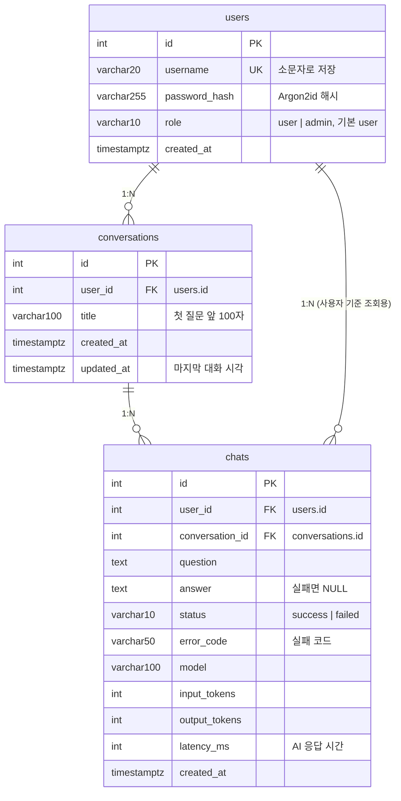

# DB·인증·공통 기반 (백엔드 A)

담당: 이상우. 설계 이슈: #1(ERD·DB·인증), #2(공통 기반). 구현 PR: #4(공통 기반), #6(DB), #7(인증), #28(정적 파일 요청 로그).
채팅의 저장·조회 함수는 백엔드 B(`docs/chat.md`), 기록 조회 `list_chats`는 PM(`docs/history.md`)이 이 문서의 테이블과 인증 의존성 위에 구현했습니다.

## ERD



| 테이블 | 한 행 | 제약·인덱스 |
|---|---|---|
| `users` | 회원 1명 | `username` UNIQUE, `role` CHECK(`user`·`admin`) |
| `conversations` | 대화방 1개 | `(user_id, updated_at)` 인덱스 — 내 대화방 목록 |
| `chats` | 질문·응답 한 쌍 | `status` CHECK(`success`·`failed`), `(conversation_id, created_at)` 인덱스 — 같은 방의 최근 문맥, `(user_id, created_at)` 인덱스 — 내 전체 기록 |

모델은 `app/db/models/`에 테이블마다 파일 하나로 둡니다. 시각은 모두 시간대를 포함한 `timestamptz`(UTC)입니다.

### 설계 결정

| 결정 | 이유 |
|---|---|
| `chats` 한 행 = 질문·응답 한 쌍, AI 실패도 저장 | 실패도 `status=failed`·`answer=NULL`·`error_code`로 남겨 사용자 기준 실패 이력까지 추적합니다. 문맥에는 성공 기록만 씁니다(B). |
| `conversations` 테이블로 대화방 구분 | 문맥을 "같은 대화방의 최근 대화"로 만들고, 방 목록과 방별 기록을 조회합니다. |
| `chats.user_id`를 일부러 중복 저장 | 대화방을 거쳐 알 수 있지만, 기록은 추가만 되고 방 주인도 바뀌지 않아 어긋날 일이 없습니다. 대신 사용자 기준 조회가 JOIN 없이 `(user_id, created_at)` 인덱스 하나로 끝납니다(#15 `list_chats`). 저장할 때 대화방의 `user_id`를 그대로 씁니다(B `save_chat`). |
| 사용량은 기록만, 합계·비용은 저장하지 않음 | 모델·토큰 수·응답 시간은 행마다 남기고, 합계·비용은 이 값으로 계산합니다. |
| `role` 컬럼만 먼저 둠 | 지금은 전원 `user`입니다. 가입 요청으로 받지 않고(권한 상승 방지) 토큰에도 넣지 않습니다. 관리자 기능은 핵심 기능 이후 검토합니다. |
| 테이블 생성은 앱 시작 시 `create_all` | 없는 테이블만 만들고 있는 테이블은 건드리지 않습니다. 마이그레이션 도구가 없으므로 컬럼을 바꾸면 개발 DB를 다시 만듭니다. 테이블 변경은 이슈를 만들고 백엔드 A를 담당자로 지정합니다(CONTRIBUTING). |

## DB 연결

`app/db/database.py`가 엔진·세션·`SessionDep`을 제공합니다. 라우트는 `db: SessionDep`으로 세션을 받습니다.

- **앱은 PostgreSQL로만 실행합니다.** 배포는 Render Postgres, 로컬은 Docker Postgres(README) 또는 개인 Render Postgres입니다. SQLite는 테스트 기본값(메모리 DB)으로만 씁니다. SQLite는 문자열 길이를 검사하지 않고 시간대를 버려서, 앱을 SQLite로 돌리면 응답이 배포와 달라집니다.
- Render가 주는 `postgres://`·`postgresql://` 주소는 psycopg 3 드라이버 주소로 자동 변환합니다. `DATABASE_URL`이 비어 있으면 안내 문구와 함께 서버가 시작하지 않습니다. 주소에는 비밀번호가 있어 로그에는 DB 종류만 남깁니다.
- `pool_pre_ping=True`: Render 무료 Postgres는 쉬는 연결을 끊으므로 연결을 쓰기 전에 살아 있는지 확인합니다.
- 세션은 요청마다 열고 닫습니다. commit은 세션 의존성이 아니라 각 영역 코드(repository·service)가 직접 하고, commit하지 않은 변경은 요청이 끝나면 버려집니다.
- **`expire_on_commit=False`** 로 둡니다. commit 뒤에도 객체 속성을 다시 조회하지 않고 읽을 수 있습니다. 채팅 서비스(B)는 AI 응답을 기다리기 전에 commit해 DB 연결을 돌려주고(`app/chat/service.py`의 `_prepare`) 그 뒤에도 대화방 객체를 계속 씁니다. 이 값을 `True`로 바꾸면 commit 뒤 대화방 객체를 처음 읽을 때 행을 다시 조회하는데, AI 실패 처리에서는 이 조회가 이벤트 루프에서 동기로 실행되므로 바꾸지 않습니다.
- 테스트용 SQLite는 외래키 검사를 켭니다(기본이 꺼져 있어 없는 사용자 번호로도 저장되기 때문).

## 인증

### API

| 요청 | 동작 | 응답 |
|---|---|---|
| `POST /api/auth/signup` | 회원가입. 로그인은 따로 합니다 | 201 `{id, username}` · 409 `USERNAME_TAKEN` · 422 |
| `POST /api/auth/login` | 토큰을 HttpOnly 쿠키와 body `access_token`으로 함께 내려줍니다 | 200 · 401 `INVALID_CREDENTIALS` · 422(필드 누락·길이 초과) |
| `POST /api/auth/logout` | 쿠키를 지웁니다. 로그인하지 않았어도 성공 | 204 |
| `GET /api/auth/me` | 로그인한 사용자 | 200 `{id, username}` · 401 `UNAUTHORIZED` |

요청·응답 예시와 오류 형식은 `/docs`에 있습니다.

### 흐름

1. **가입**: 아이디는 3~20자 영문·숫자·`_`이고 소문자로 바꿔 저장합니다. 비밀번호는 8~64자이며 Argon2id 해시만 저장합니다. 같은 아이디로 동시에 가입하면 DB의 UNIQUE 위반으로 판단해 409를 돌려줍니다.
2. **로그인**: 아이디로 사용자를 찾고 비밀번호를 검증한 뒤 JWT(HS256, `sub`=user_id, 기본 60분 만료)를 발급합니다. 쿠키는 `HttpOnly`·`SameSite=Lax`·`Secure`(`COOKIE_SECURE`)이고 토큰과 같이 만료됩니다.
3. **인증이 필요한 요청**: `Authorization: Bearer` 헤더를 먼저 보고 없으면 쿠키를 봅니다. 서명·만료를 확인한 뒤 사용자를 **매 요청 DB에서 다시 읽어** 라우트에 넘깁니다. 토큰이 없거나 만료·위조됐거나 사용자가 없으면 401입니다.
4. **로그아웃**: 쿠키를 지웁니다. 서버가 토큰 목록을 저장하지 않으므로 이미 발급한 토큰은 만료 전까지 유효합니다.

프론트엔드는 같은 서버에서 제공되므로(#13) 쿠키만으로 인증합니다. body의 `access_token`과 Bearer 헤더는 `/docs`의 Authorize 버튼, 테스트, 프론트를 다른 주소에 따로 배포하는 경우에 씁니다.

### 다른 영역에서 쓰는 법

```python
from app.auth.dependencies import CurrentUser, OptionalUser
from app.db.database import SessionDep


@router.get("/api/me/chats")
def my_chats(user: CurrentUser, db: SessionDep): ...  # 비로그인이면 401 UNAUTHORIZED


def page(user: OptionalUser): ...  # 비로그인이면 None
```

B의 `/api/chat`·`/api/conversations`와 PM의 `/api/me/chats`가 `CurrentUser`를 씁니다. 요청 로그의 `user_id`도 같은 토큰 해석 함수로 채웁니다(서명·만료만 확인하고 DB는 보지 않음).

### 결정과 이유

| 결정 | 이유 |
|---|---|
| JWT, 쿠키·헤더 양쪽 전달 | 설계 당시(#1) 프론트를 어떻게 제공할지 정해지지 않아 어느 방식이든 그대로 동작하게 했습니다. #13에서 같은 FastAPI가 화면을 제공하기로 정해 프론트는 HttpOnly 쿠키만 씁니다. |
| `HttpOnly`·`SameSite=Lax` 쿠키 | 자바스크립트가 토큰을 읽지 못해 XSS가 생겨도 토큰을 훔쳐 갈 수 없고, 다른 사이트에서 보낸 POST에는 쿠키가 붙지 않습니다(CSRF 완화). |
| Argon2id, OWASP 최소 파라미터(메모리 19MiB·반복 2·병렬 1) | 라이브러리 기본값(64MiB·3·4)은 Render 무료 인스턴스(RAM 512MB·CPU 0.1)에 무겁습니다. bcrypt와 달리 72바이트 입력 제한이 없습니다. |
| 아이디 소문자 통일 | `Admin`과 `admin`이 서로 다른 계정이 되는 사칭을 막습니다(팀 결정). |
| 없는 아이디와 틀린 비밀번호는 같은 응답 | 응답 내용이나 응답 시간으로 가입된 아이디를 알아내지 못하게 합니다. 없는 아이디도 더미 해시로 비밀번호 검증을 한 번 거쳐 응답 시간 차이를 없앱니다. |
| 토큰에는 user_id만, role은 넣지 않음 | 사용자를 매 요청 DB에서 읽으므로 역할 변경·삭제가 토큰 만료를 기다리지 않고 바로 반영됩니다. |
| 서명 알고리즘을 HS256으로 고정 | 토큰 헤더의 알고리즘을 믿으면 서명 없는 `none` 토큰이 통과할 수 있습니다. |
| `JWT_SECRET` 32바이트 이상, 없으면 시작 거부 | 짧은 키는 무차별 대입으로 찾을 수 있습니다. 첫 로그인 때가 아니라 서버 시작 때 알 수 있게 합니다. |
| 로그인 실패 로그에 입력한 아이디를 남기지 않음 | 아이디 칸에 비밀번호를 잘못 입력하면 로그에 비밀번호가 남습니다. 실패 이유(`unknown_user`·`wrong_password`)와 user_id만 남깁니다. |

## 공통 기반 (#2)

- **응답 형식**: 성공 응답은 감싸지 않고, 목록은 `{"items": [...]}`, 오류는 `{"error": "코드", "message": "안내"}`입니다. 전역 예외 처리기가 `AppError`·404·405·422를, 요청 미들웨어가 처리되지 않은 예외(500)를 이 형식으로 바꿉니다. 422의 상세 필드와 500의 원인은 응답에 넣지 않고 서버 로그에만 남깁니다.
- **오류 코드**: `app/core/errors.py`의 `ErrorCode`와 설명 표 한 곳에 모으고 `/docs`에 자동으로 표시합니다. 영역별 코드(B의 `AI_*`·`DB_ERROR`)도 여기에 추가합니다.
- **서버 로그**: stdout에 `이벤트명 key=value` 한 줄씩, UTC 시각으로 남깁니다. 요청 미들웨어가 요청마다 `request_id`를 만들어(클라이언트가 보낸 값은 쓰지 않음) 응답 헤더 `X-Request-ID`로 내려주고, 같은 요청 안에서 `log_event`로 남기는 로그에 `request_id`·`user_id`를 자동으로 붙입니다. 값의 줄바꿈 등은 이스케이프해 가짜 로그 줄을 끼워 넣을 수 없습니다. HTTP 클라이언트(httpx) 로그는 요청 URL에 키가 들어갈 수 있어 WARNING 이상만 남깁니다.
- **정적 파일 요청 로그**: 화면을 한 번 열 때 `/static/` 파일 12개가 로그를 24줄 남겨 `DEBUG`로 낮췄습니다(#28). 실패(4xx·5xx)는 `INFO`로 남기고 경로를 함께 기록합니다.
- **`/docs`**: 엔드포인트마다 응답 모델·예시·날 수 있는 오류를 선언해 API 명세로 씁니다.

## 설정

값과 기본값은 README 환경 변수 표에 있습니다. 배포할 때 A 영역에서 확인할 것은 다음과 같습니다.

| 변수 | 배포 시 |
|---|---|
| `DATABASE_URL` | Render Postgres 주소를 그대로 넣습니다(드라이버 주소는 자동 변환). |
| `JWT_SECRET` | `uv run python -c "import secrets; print(secrets.token_urlsafe(32))"`로 새로 만든 값을 넣습니다. 바꾸면 이미 발급한 토큰이 모두 무효가 됩니다. |
| `JWT_EXPIRE_MINUTES` | 기본 60분. 쿠키도 같이 만료됩니다. |
| `COOKIE_SECURE` | 기본 `true`. 배포(https)에서는 그대로 두고, 로컬 http 개발에서만 `false`로 둡니다. |
| `CORS_ORIGINS` | 프론트를 같은 서버에서 제공하므로 비워 둡니다. 다른 주소에 따로 배포할 때만 그 주소를 넣습니다. |
| `LOG_LEVEL` | 기본 `INFO`. `DEBUG`로 바꾸면 정적 파일 요청 로그도 보입니다. |

## 검증 방법

```text
uv run pytest
uv run ruff format --check
uv run ruff check
```

기본은 메모리 SQLite입니다. PostgreSQL은 README처럼 `TEST_DATABASE_URL`을 지정해 같은 명령을 실행합니다. 테스트가 테이블을 다시 만들므로 이름에 `test`가 들어간 전용 DB를 씁니다.

자동 테스트가 확인하는 것:

- **DB**: Render 주소 변환, 주소 없을 때 시작 중단, 라우트에 세션 주입, 외래키·UNIQUE·CHECK 제약, 인덱스와 테이블 3개 생성. 문자열 길이 제약과 시간대 유지는 SQLite가 검사하지 않아 PostgreSQL 실행에서만 확인합니다(SQLite 실행의 `2 skipped`)
- **인증**: 가입 시 소문자 저장·해시 저장·role 무시·입력 범위, 대소문자 무시 중복 가입 거부, 로그인 쿠키 속성, 실패 응답·로그에 입력값 미노출, 로그아웃 후 401, 헤더가 쿠키보다 우선, Argon2id 파라미터, 토큰 만료·다른 키·위조·`none` 알고리즘·만료 없는 토큰 거부, 키 없을 때 시작 중단
- **공통 기반**: 오류 형식 변환(404·405·422·500), 422 상세 미노출, `request_id` 생성·전달, 요청 로그의 `user_id`, 로그 한 줄 유지(인젝션 방지), CORS 설정, 정적 파일 로그 레벨

직접 확인할 때는 서버를 띄운 뒤 쿠키로 로그인 흐름을 따라갑니다.

```sh
curl -i -c cookies.txt -X POST http://127.0.0.1:8000/api/auth/signup \
  -H 'Content-Type: application/json' -d '{"username":"sangwoo","password":"password123"}'
curl -i -c cookies.txt -X POST http://127.0.0.1:8000/api/auth/login \
  -H 'Content-Type: application/json' -d '{"username":"sangwoo","password":"password123"}'
curl -b cookies.txt http://127.0.0.1:8000/api/auth/me
```

로그인 응답의 `Set-Cookie`에 `HttpOnly`·`SameSite=lax`가 있고, `/me`가 `{"id": …, "username": "sangwoo"}`를 돌려주면 됩니다. DB에는 `password_hash`가 `$argon2id$`로 시작하는 값으로 저장됩니다.

2026-10-13 검증: develop 기준 SQLite 242 passed·2 skipped(PostgreSQL 전용), PostgreSQL 244 passed, Ruff 통과. 정적 파일 로그 테스트가 들어간 #28 브랜치 기준으로는 SQLite 248 passed·2 skipped, PostgreSQL 250 passed입니다. 리뷰 과정에서 B(#12)·PM(#15)·FE(#26)의 코드가 이 문서의 테이블·세션·인증 의존성을 계약대로 쓰는지 확인했습니다.
