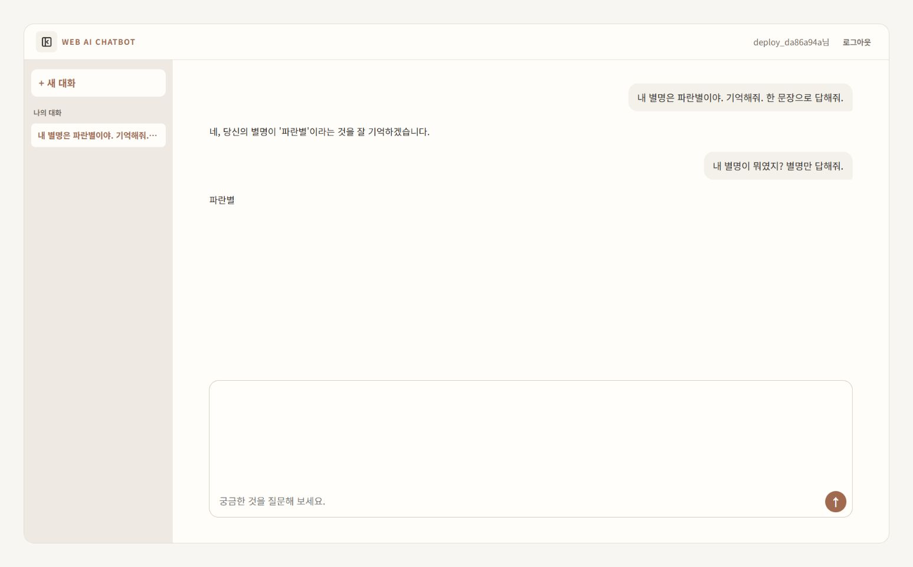

# 배포 검증 증빙

확인일: 2026-10-15. 서비스: https://web-ai-chatbot-33yw.onrender.com

## 실제 서비스 확인

| 확인 대상 | 결과 | 근거 |
| --- | --- | --- |
| 서버의 실제 AI 호출·문맥 유지 | 코디세이 `gemini-3.1-flash-lite`로 2회 호출, 후속 질문에서 별명 기억 | 초기 배포 `e4bb43e`, [실제 서버 로그](evidence/ai-chat-events.log)와 결과 JSON |
| 필수 이벤트 로그 | 요청 수신·AI 호출 시작·AI 응답·DB 저장 성공을 같은 요청 ID로 추적 | 로그의 `request_id=58712a9fa7ce` |
| 서비스 재시작 후 DB 기록 | 새 로그인으로 기존 성공 기록 2건 재조회 | 초기 배포 검증 결과의 `history_rows_after_service_restart` |
| 최신 코드 재배포 | `69f642b` 배포 성공, 제공되는 `main.js`가 검증한 코드와 일치 | 재배포 HTTP 확인 결과 |
| 재배포 후 DB 기록 | 기존 기록 2건과 문맥 답변 유지 | 재배포 결과의 `previous_record_ids_retained` |
| 브라우저 재로그인 | 같은 페이지에서 로그아웃 → 재로그인 후 기존 방 1개 복구, 선택하면 질문·답변 표시 | 아래 원본 화면과 브라우저 확인 결과 |
| 공개 접속·접근 제어 | 화면·상태 확인·API 명세 200, 비로그인 채팅·기록 조회 401 | 재배포 HTTP 확인 결과 |

전체 결과는 [검증 JSON](evidence/verification-2026-10-15.json)에서 확인합니다. 초기 실제 AI 검증과 이후 재배포 검증을 구분해 기록했습니다. 재배포 확인에서는 저장된 대화를 사용했고 실제 AI를 추가 호출하지 않았습니다.

### 재로그인 후 대화방·기록 확인 화면



화면의 계정명은 검증용으로 자동 생성한 이름이고, 별명과 대화 내용도 테스트 데이터입니다. 실제 API 키·계정 비밀번호·인증 토큰·DB 접속 정보는 증빙에 포함하지 않습니다.

## 자동 테스트 확인

| 검사 | 2026-10-15 결과 |
| --- | --- |
| Python 전체 테스트 | 253 passed, 2 skipped(PostgreSQL 전용) |
| JavaScript 전체 테스트 | 48 passed |
| Ruff check·format check | 통과 |
| 배포 검증 스크립트 회귀 테스트 | 위 Python 결과에 포함된 6개 통과 |

```text
uv run pytest
node --test tests/*.test.mjs
uv run ruff check
uv run ruff format --check
```

기본 Python 테스트는 격리된 메모리 SQLite를 사용합니다. 스크립트 회귀 테스트는 실제 FastAPI·인증·기록 저장/조회 경로를 통과하고 AI 응답만 모의 처리합니다. 사용자·응답·상태·생성 시각이 잘못된 기록과 재로그인 후 사라진 기록을 실패로 판정하는지 검사했습니다. 운영 DB와 실제 AI 호출은 사용하지 않았습니다.

이 자동 테스트 결과는 위의 실제 코디세이·운영 PostgreSQL·외부 URL 확인 결과와 각각 기록했습니다.

## 평가자가 직접 확인하기

[배포 가이드의 기능·DB 확인 순서](deployment.md#평가-시-기능db-기록-확인)를 따릅니다. 로그인한 브라우저의 새 탭에서 `/api/me/chats?limit=10`을 열면 본인의 사용자 ID·시각·질문·응답을 확인할 수 있습니다.

개발용 서버에서는 [채팅 검증 스크립트](../scripts/smoke_chat.py)로 API 기준 가입·질문·기록 조회·로그아웃·재로그인을 확인할 수 있습니다. 실행 방법과 실제 AI 호출 2회·검증 계정 및 기록 생성 범위는 [채팅 문서](chat.md#검증-방법)에 적었습니다. 브라우저 표시와 서비스 재시작 후 보존 여부는 별도로 확인합니다.
